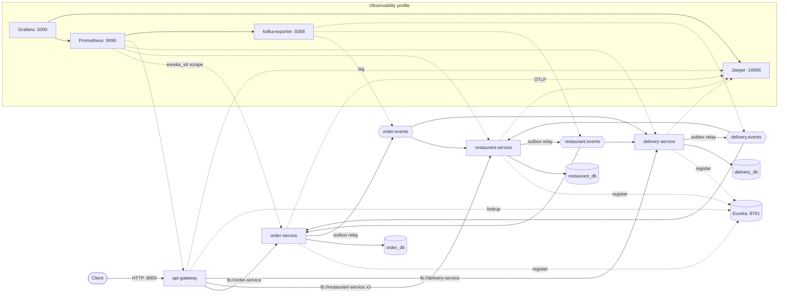
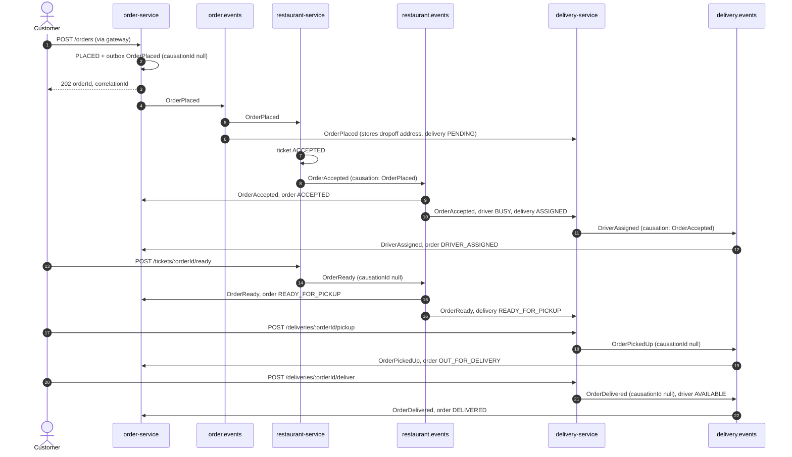
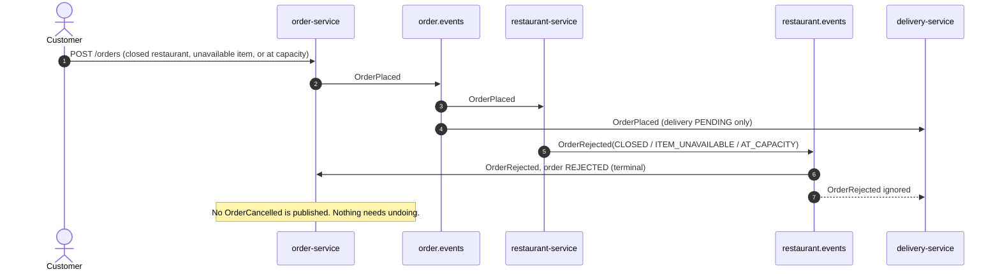
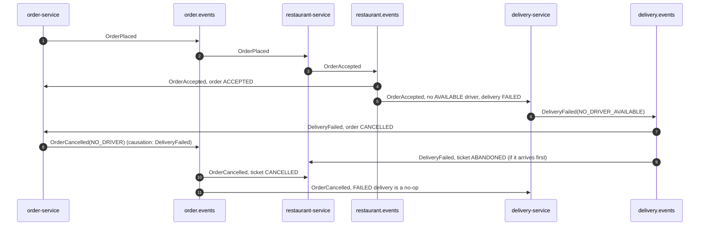
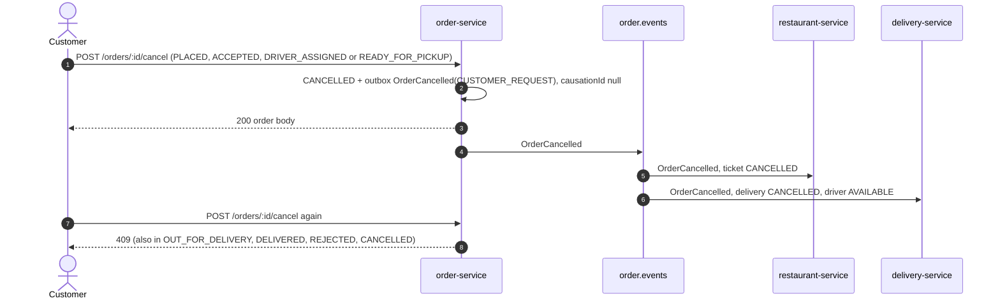
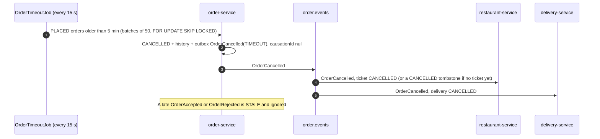

# Food delivery saga on Kafka

A learning project. Three Spring Boot services (Order, Restaurant, Delivery) run a food-order saga by choreography over Apache Kafka (KRaft mode). Each service has its own PostgreSQL database, a transactional outbox, idempotent consumers, and non-blocking retry topics with dead-letter topics. Eureka and Spring Cloud Gateway sit in front of the HTTP side. Prometheus, Grafana and Jaeger show what happens.

- Original spec: [docs/spec.md](docs/spec.md)
- Design decisions: [docs/adr/](docs/adr/)

Stack: Java 17, Spring Boot 3.5.16, Spring Cloud 2025.0.3, Flyway, PostgreSQL 16, Kafka 3.9.1 (`apache/kafka`), Kafka UI v0.7.2.

## How to run

### Prerequisites
- JDK 17 (check with `java -version`)
- Docker Desktop (check with `docker version`)
- Git Bash on Windows, or any POSIX shell. PowerShell 5.1 works for `scripts\verify.ps1` and `scripts\demo.ps1`.
- About 6 GB of free RAM for the full stack.

### 1. Start the infrastructure

```bash
docker compose up -d
bash scripts/check-topics.sh
```

This starts Kafka (KRaft, one broker), `kafka-init` (creates the 27 topics and exits), Kafka UI and Postgres. `check-topics.sh` exits 0 when the topics, partition counts and `auto.create.topics.enable=false` are right.

### 2a. Host mode (run the 3 services with `java -jar`)

Use this for milestones M1 to M8. Postgres is on host port **5433**, not 5432.

```bash
./mvnw -B -q package -DskipTests
java -jar order-service/target/order-service.jar        # :8081
java -jar restaurant-service/target/restaurant-service.jar   # :8082
java -jar delivery-service/target/delivery-service.jar       # :8083
```

Run each `java -jar` in its own terminal. Defaults: Kafka `localhost:9092`, Postgres `localhost:5433`, Eureka off. Call the services directly on 8081 to 8083.

### 2b. Compose mode (everything in containers, behind the gateway)

```bash
./mvnw -B -q package -DskipTests
docker compose --profile apps --profile obs up -d --build --scale restaurant-service=3
bash scripts/wait-for-stack.sh
```

`wait-for-stack.sh` polls for up to 180 s until Eureka lists ORDER-SERVICE x1, RESTAURANT-SERVICE x3, DELIVERY-SERVICE x1 and API-GATEWAY x1, the gateway answers, and Prometheus and Jaeger are ready. The services publish no host ports. Use the gateway on :8000.

**Do not mix host mode and Compose mode.** Eureka would advertise addresses that the other side cannot reach. Stop one before you start the other.

### Verify

```bash
bash scripts/verify.sh [--full] [--down]
```
```powershell
scripts\verify.ps1 [-Full] [-Down]
```

Without `--full` it checks Docker, CR characters in scripts, `./mvnw -B clean install` (clean, because an IDE language server can leave stale classes in `target/`; unit and integration tests with Testcontainers; `install` refreshes `~/.m2` so the `-pl e2e-tests` step resolves the current modules; the apps/obs containers are stopped first so the ITs do not compete with them for RAM), the `KafkaTemplate` grep and `check-topics.sh`. With `--full` it also starts the Compose stack, waits for it, checks the consumer group and runs the E2E tests (`./mvnw -B -Pe2e verify -pl e2e-tests`). `--down` stops the stack at the end.

The prod-like check (3 brokers, RF 3, min ISR 2) is manual and cannot run together with the default stack, because both use host port 9092:

```bash
docker compose -f docker-compose.prodlike.yml up -d && bash scripts/check-topics.sh --prodlike
```

### Demo

With the Compose stack up. Everything goes through the gateway.

```bash
bash scripts/demo.sh happy       # order is delivered
bash scripts/demo.sh reject      # closed restaurant, order REJECTED
bash scripts/demo.sh nodriver    # all drivers OFFLINE, order CANCELLED (drivers are restored)
bash scripts/demo.sh cancel      # customer cancels in DRIVER_ASSIGNED
bash scripts/demo.sh poison      # a non-JSON record lands on a DLT
```
PowerShell: `scripts\demo.ps1 happy` (same names).

Each scenario prints the order id, the correlationId and the Jaeger link.

### URLs

| What | URL |
|---|---|
| API gateway (all REST calls) | http://localhost:8000 |
| Eureka | http://localhost:8761 |
| Kafka UI | http://localhost:8080 |
| Prometheus | http://localhost:9090 |
| Grafana (admin/admin, dashboard `saga-overview`) | http://localhost:3000 |
| Jaeger | http://localhost:16686 |
| Postgres (user `app`, password `app`) | localhost:5433 |

Seed data for manual calls:

- Restaurant "Pasta Place" `11111111-1111-1111-1111-111111111111` (open, max 5 orders). Menu: Margherita `22222222-2222-2222-2222-000000000001` at 12.50, Lasagne `...0002` at 14.00, Truffle Special `...0003` (unavailable).
- Restaurant "Night Grill" `11111111-1111-1111-1111-111111111112` (closed).
- Drivers `33333333-3333-3333-3333-000000000001` to `...0005`, all AVAILABLE.

Place an order by hand:

```bash
curl -s -X POST http://localhost:8000/orders -H 'Content-Type: application/json' -d '{
  "customerId":"99999999-9999-9999-9999-999999999999",
  "restaurantId":"11111111-1111-1111-1111-111111111111",
  "items":[{"menuItemId":"22222222-2222-2222-2222-000000000001","quantity":2,"unitPrice":12.50}],
  "deliveryAddress":"5 Demo Road"}'
```
It returns 202 with `{orderId, status:"PLACED", correlationId}`. The kitchen and the driver do not advance on their own (`simulation.auto-advance=false`), so you call `POST /tickets/{orderId}/ready`, `POST /deliveries/{orderId}/pickup` and `POST /deliveries/{orderId}/deliver` yourself.

### Windows notes

- **Git Bash `grep` needs `-U` to see CR.** Without it, grep strips the CR and a CRLF check never matches. The CR check in `verify.sh` uses `grep -rlIU`.
- **`$'\r'` inside `$( )` turns into an empty string.** An empty pattern matches every file. Put it in a variable first: `cr=$'\r'; grep -rlIU "$cr" scripts`.
- **Do not export `MSYS_NO_PATHCONV` around `./mvnw`.** It stops Git Bash from converting the `/c/...` classpath and Maven fails with "Could not find or load main class ...Launcher". Scripts that call `docker compose exec ... /opt/kafka/bin/...` do need it (`check-topics.sh`, `demo.sh` set it themselves).
- **`python3` is a Microsoft Store stub on Windows.** It hangs waiting for stdin. No script here uses python. Use `grep`, `sed` and `cut`.
- **Docker is not on Git Bash's PATH by default.** If `docker` is not found, add the `resources\bin` folder of your Docker Desktop install to `PATH`, or use PowerShell.
- **Do not edit sources while Maven runs if an IDE language server is active.** The IDE can recompile into `target/` in the middle of a build and make tests fail. Re-run with a clean build.
- **Port 5432 is taken by a native Windows Postgres** on the project owner's machine, so Compose publishes Postgres on 5433. Override with `POSTGRES_HOST_PORT`.
- All text files are LF (`.gitattributes`: `* text=auto eol=lf`), including shell and PowerShell scripts; only `mvnw.cmd` is CRLF. The CR check in `verify` scans `scripts`, `mvnw`, `docker` and `infra`.

## Architecture



**Kafka traffic does not go through discovery.** Services find the brokers through `bootstrap.servers`, and consumer groups balance partitions among their members through the Kafka group protocol. Eureka and the gateway are only for HTTP.

The 3 services:

| Service | Owns | Publishes | Consumes |
|---|---|---|---|
| order-service (8081) | orders, items, status history | `order.events` | `restaurant.events`, `delivery.events` |
| restaurant-service (8082) | restaurants, menu items, tickets | `restaurant.events` | `order.events`, `delivery.events` |
| delivery-service (8083) | drivers, deliveries | `delivery.events` | `order.events`, `restaurant.events` |

Each service writes events to its `outbox` table in the same transaction as its business change. A relay publishes the rows to Kafka. See [Reliability](#reliability).

Modules: `common-events` (envelope, payloads, codec, topic list), the 3 services, `discovery-server`, `api-gateway`, `e2e-tests`.

## Topic and event catalogue

### Topics (27)

Broker auto-create is off. `kafka-init` creates exactly these. Replication factor is 1 (3 in the prod-like file).

| Topic | Partitions | Producer | Consumer groups |
|---|---|---|---|
| `order.events` | 3 | order-service | restaurant-service, delivery-service |
| `restaurant.events` | 3 | restaurant-service | order-service, delivery-service |
| `delivery.events` | 3 | delivery-service | order-service, restaurant-service |
| `<src>.events.<group>.retry-0`, `.retry-1`, `.retry-2` (18 topics) | 3 | Spring Kafka retry | the same group |
| `<src>.events.<group>.dlt` (6 topics) | 1 | Spring Kafka | the same group's `@DltHandler`, and you |

The 6 (source, group) pairs: `order.events` with `restaurant-service` and `delivery-service`; `restaurant.events` with `order-service` and `delivery-service`; `delivery.events` with `order-service` and `restaurant-service`. Example: `order.events.restaurant-service.retry-1`.

**Why per group:** each main topic has two consumer groups. A shared retry topic would be read by both groups, so a record that failed in one group would be processed again by the other. See [ADR 0004](docs/adr/0004-per-group-retry-and-dlt-topics.md).

**Key = orderId** on every record, so all events of one order from one producer share a partition and keep their order ([ADR 0001](docs/adr/0001-topic-per-producer-keyed-by-order-id.md)).

### Envelope and headers

Every record value is this JSON ([ADR 0002](docs/adr/0002-json-envelope-and-common-events-module.md)):

```json
{
  "eventId": "uuid",
  "eventType": "OrderPlaced",
  "eventVersion": 1,
  "occurredAt": "2026-11-18T10:15:30Z",
  "orderId": "uuid",
  "correlationId": "uuid",
  "causationId": "uuid or null",
  "payload": { }
}
```

- `correlationId` is the same for the whole saga. `causationId` is the `eventId` of the event that caused this one.
- `causationId` is **null** (but present) for events started by REST or by a scheduler: `OrderPlaced`, customer `OrderCancelled`, timeout `OrderCancelled`, `OrderReady` from `POST /tickets/{id}/ready` or auto-advance, `OrderPickedUp`, `OrderDelivered`, and `DeliveryFailed(DRIVER_CANCELLED)`.
- Kafka headers `eventType`, `eventVersion`, `correlationId` carry the same values as UTF-8 strings. A mismatch with the envelope is a poison message.

### Events (9)

| Event | Payload | Producer | Consumers |
|---|---|---|---|
| `OrderPlaced` | customerId, restaurantId, items[{menuItemId, quantity, unitPrice}], totalAmount, deliveryAddress | order | restaurant, delivery (stores dropoff address) |
| `OrderCancelled` | reason: CUSTOMER_REQUEST, NO_DRIVER, TIMEOUT (RESTAURANT_REJECTED is reserved and never emitted) | order | restaurant, delivery |
| `OrderAccepted` | restaurantId, estimatedPrepMinutes, pickupAddress | restaurant | order, delivery (assigns a driver) |
| `OrderRejected` | restaurantId, reason: CLOSED, ITEM_UNAVAILABLE, AT_CAPACITY | restaurant | order (delivery ignores it) |
| `OrderReady` | restaurantId, readyAt | restaurant | order, delivery |
| `DriverAssigned` | driverId, driverName, etaMinutes | delivery | order |
| `DeliveryFailed` | reason: NO_DRIVER_AVAILABLE, DRIVER_CANCELLED | delivery | order, restaurant |
| `OrderPickedUp` | driverId, pickedUpAt | delivery | order |
| `OrderDelivered` | driverId, deliveredAt | delivery | order |

Consumers skip event types they do not handle, without recording them.

## Saga flows

Each service writes the event to its outbox, and the relay sends it to the topic of that service. The diagrams show topics as participants and leave the relay out.

### Happy path



`DriverAssigned` and `OrderReady` come from two different topics, so the order can also see `OrderReady` first. Both are valid ([Order state machine](#order-state-machine)).

### Restaurant rejects



### No driver available (compensation)



The restaurant sees `DeliveryFailed` and `OrderCancelled` from two topics. In either arrival order the ticket ends CANCELLED ([ADR 0006](docs/adr/0006-ticket-final-state-cancelled.md)). A driver who goes OFFLINE before pickup (`PATCH /drivers/{id}`) gives `DeliveryFailed(DRIVER_CANCELLED)` and the same compensation.

### Customer cancels



Unknown order gives 404. A cancel can race a pickup. The late `OrderPickedUp` is STALE in Order and Delivery logs a WARN. This is a known race and it is not prevented.

### Timeout



The age limit is `orders.timeout.placed-max-age` (default `PT5M`) and the scan runs every `PT15S`. With several order-service instances, `SKIP LOCKED` makes sure only one cancels each order.

## Order state machine

```
PLACED -> ACCEPTED -> DRIVER_ASSIGNED -> READY_FOR_PICKUP -> OUT_FOR_DELIVERY -> DELIVERED
             \-> READY_FOR_PICKUP -> DRIVER_ASSIGNED -/
PLACED -> REJECTED
PLACED, ACCEPTED, DRIVER_ASSIGNED, READY_FOR_PICKUP -> CANCELLED
```

Terminal states: DELIVERED, REJECTED, CANCELLED. Every event in a terminal state is STALE. Every applied transition is stored in `order_status_history`, including the first `null -> PLACED`.

`OrderStateMachine.decide(status, hasDriver, readySeen, input)` returns one of three results:

- **APPLY**: valid transition. State, history row and outbox row are written in one transaction.
- **PREMATURE**: the cause of the event has not been applied yet. The handler throws, the transaction rolls back and the record goes through the retry topics.
- **STALE**: the event is behind the current state. It is logged and recorded in `processed_events`. It is not retried and not sent to the DLT.

`hasDriver` means the order has a `driver_id`. `readySeen` means the history contains `READY_FOR_PICKUP`. Any pair not listed below is STALE.

| Input | APPLY (from -> to) | PREMATURE when status is |
|---|---|---|
| OrderAccepted | PLACED -> ACCEPTED | never |
| OrderRejected | PLACED -> REJECTED (no OrderCancelled) | never |
| OrderReady | ACCEPTED or DRIVER_ASSIGNED -> READY_FOR_PICKUP | PLACED |
| DriverAssigned | ACCEPTED -> DRIVER_ASSIGNED; READY_FOR_PICKUP without driver -> DRIVER_ASSIGNED | PLACED |
| DeliveryFailed | ACCEPTED, DRIVER_ASSIGNED, READY_FOR_PICKUP -> CANCELLED, emits OrderCancelled(NO_DRIVER) | PLACED |
| OrderPickedUp | READY_FOR_PICKUP with driver -> OUT_FOR_DELIVERY; DRIVER_ASSIGNED with readySeen -> OUT_FOR_DELIVERY | PLACED, ACCEPTED, DRIVER_ASSIGNED without readySeen, READY_FOR_PICKUP without driver |
| OrderDelivered | OUT_FOR_DELIVERY -> DELIVERED | PLACED, ACCEPTED, DRIVER_ASSIGNED, READY_FOR_PICKUP |
| Customer cancel (REST) | PLACED, ACCEPTED, DRIVER_ASSIGNED, READY_FOR_PICKUP -> CANCELLED, emits OrderCancelled(CUSTOMER_REQUEST) | not an event: any other state gives 409 |
| Timeout job | PLACED older than the limit -> CANCELLED, emits OrderCancelled(TIMEOUT) | not an event |

The only two valid happy-path histories are:

```
null > PLACED > ACCEPTED > DRIVER_ASSIGNED > READY_FOR_PICKUP > OUT_FOR_DELIVERY > DELIVERED
null > PLACED > ACCEPTED > READY_FOR_PICKUP > DRIVER_ASSIGNED > OUT_FOR_DELIVERY > DELIVERED
```

**Why cross-topic order is not guaranteed.** Kafka orders records per partition. Order Service reads `restaurant.events` and `delivery.events`, which are different topics, so it can see `DriverAssigned` and `OrderReady` in either order, or even `OrderPickedUp` before the event that should precede it. Non-blocking retry topics add more reordering, because a record parked on a retry topic is overtaken by later records with the same key. That is why "early" is not the same as "invalid". See [ADR 0005](docs/adr/0005-premature-vs-stale-events.md). The trade-off: a premature event waits 1 s, 5 s or 25 s before the next attempt. If it never becomes valid it ends on the DLT with an ALERT.

## Reliability

### Transactional outbox

The problem: "update the database and publish to Kafka" is a dual write. If the commit works and the send fails, the event is lost. If the send works and the commit fails, the event describes something that never happened. M2 to M5 show this on purpose with a direct `KafkaTemplate` call.

The fix, in all 3 services ([ADR 0003](docs/adr/0003-transactional-outbox-with-advisory-lock-relay.md)):

1. The handler writes the business change and an `outbox` row in one transaction. The row holds the envelope JSON and a W3C `traceparent`.
2. `OutboxRelay` runs every 500 ms. In one transaction it takes `pg_try_advisory_xact_lock(hashtext('<service>-outbox'))` and returns if another instance holds it. So only one relay per service is active, even when scaled.
3. It reads up to 100 unpublished rows `ORDER BY id FOR UPDATE`, sends each with key = `aggregate_id`, waits up to 10 s for the ack and sets `published_at`.
4. At the first failure it **stops the batch** and commits the rows already marked. Later rows are not sent ahead of an earlier one.

`outbox.payload` is `jsonb`, which changes key order and spacing. The relay re-encodes it to canonical JSON before sending, in all 3 services. Producers use `acks=all` and `enable.idempotence=true`.

**Outbox crash test** (`OutboxCrashIT`): pause the Kafka container, `POST /orders` still returns 202 and the outbox row stays unpublished for 5 s or more. After unpause the record arrives within 60 s and `published_at` is set. Pause and unpause are used (not stop and start), because a restart would change the mapped port.

### Delivery guarantee and idempotency

Delivery is **at-least-once**. A crash after the send and before the commit publishes a row twice, and a consumer can get a record again after a rebalance. So consumers must be idempotent.

Every handler runs in one transaction. Its first statement is `INSERT INTO processed_events (event_id, processed_at) ... ON CONFLICT DO NOTHING`. If 0 rows were inserted, the event is a duplicate: it is logged and skipped. Because the insert is in the same transaction as the state change, a rollback (for example for a PREMATURE event) also removes it, and the retry is processed.

Consumer settings: group id = service name, `auto.offset.reset=earliest`, `enable.auto.commit=false`, container ack mode RECORD.

### Retries and the dead-letter topic

Every listener uses `@RetryableTopic`: 4 attempts, delays **1 s, 5 s, 25 s** (delay 1000 ms, multiplier 5, max 30000 ms). Spring's annotation can only do exponential back-off, so this is 25 s, not the spec's 30 s ([ADR 0004](docs/adr/0004-per-group-retry-and-dlt-topics.md)).

- Transient failure: the record goes to `.retry-0`, then `-1`, `-2`, and succeeds when the problem is gone.
- **Poison message** (not JSON, unknown event type, payload mismatch, a missing `eventType`/`eventVersion`/`correlationId` header, a header that differs from the envelope, or `eventVersion` other than 1): `InvalidEventException` is not retried. The record goes straight to `.dlt` with **zero retry hops**. Try it with `bash scripts/demo.sh poison`.
- Retries exhausted: the record goes to `.dlt`.
- On every DLT record the `@DltHandler` logs `ERROR ALERT dlt topic=... key=... eventId=...` and increments the counter `kafka.dlt.records` (Prometheus name `kafka_dlt_records_total`, created on the first DLT record).
- STALE events throw nothing, so they never reach a retry topic or the DLT.

Look at a DLT:

```bash
docker compose exec -T kafka /opt/kafka/bin/kafka-console-consumer.sh \
  --bootstrap-server localhost:9092 --topic order.events.restaurant-service.dlt \
  --from-beginning --property print.key=true --timeout-ms 10000
```

### Known limits

- Non-blocking retries can reorder records for one key. The state machine handles that ([Order state machine](#order-state-machine)).
- A customer cancel can race a pickup (see [Customer cancels](#customer-cancels)).
- The outbox relay adds up to about 500 ms of latency and has one active instance per service.

## Discovery and gateway

- `discovery-server` is a Eureka server on :8761. Self-preservation is off and caches are short, so dead instances disappear within seconds.
- `api-gateway` (Spring Cloud Gateway, :8000) registers with Eureka and routes by path:

| Path | Target |
|---|---|
| `/orders/**` | `lb://order-service` |
| `/restaurants/**`, `/tickets/**` | `lb://restaurant-service` |
| `/drivers/**`, `/deliveries/**` | `lb://delivery-service` |

- Clients register with `prefer-ip-address=true`, lease renewal 5 s, expiry 15 s. Eureka is off by default (`EUREKA_ENABLED=false`) and on in Compose.
- Restaurant answers with a header `X-Instance-Id` (the container id). Check the balancing:

```bash
for i in $(seq 12); do curl -s -D - -o /dev/null http://localhost:8000/restaurants | grep -i x-instance-id; done | sort | uniq -c
```
With 3 replicas you see 3 different ids, about 4 each.

- **Scaling:** `--scale restaurant-service=3` gives 3 instances. The 3 partitions of `order.events` are spread over them, one each. Check with `bash scripts/check-consumer-groups.sh restaurant-service 3`.
- **The 6-member note:** `kafka-consumer-groups.sh --describe --group restaurant-service` shows **6 members**, not 3. Each restaurant instance runs 2 listener containers (one for `order.events`, one for `delivery.events`) in the same group. The check script counts the distinct hosts that own `order.events` partitions, which is 3.
- Kafka traffic does not go through discovery (see [Architecture](#architecture)).
- Why the gateway and Eureka come after scaling: [ADR 0010](docs/adr/0010-eureka-and-gateway-placement-after-scaling.md).

## Observability

Part of the Compose `obs` profile.

| Tool | What to look at |
|---|---|
| Prometheus :9090 | Targets: one per app instance (found through Eureka), discovery-server and kafka-exporter. `up` should be 1 for all. |
| Grafana :3000 | Dashboard **Saga overview** (uid `saga-overview`): consumer lag by group and topic, consume rate, outbox pending rows, DLT record count, HTTP p95. Datasources Prometheus and Jaeger. Login admin/admin, anonymous viewing is on. |
| Jaeger :16686 | One trace per saga. |
| Kafka UI :8080 | Topics, messages with keys, consumer groups. |

Metrics: `kafka_consumergroup_lag` (from kafka-exporter, series for all 3 groups), `outbox_pending` (gauge per service), `kafka_dlt_records_total`, `restaurant_orders_handled_total`, and the standard HTTP and JVM metrics.

**Find the trace of one saga:**

1. `POST /orders` returns a `correlationId`, for example `031bf4a9-1563-ef64-7556-1ce689c3b4e0`.
2. Remove the dashes: `031bf4a91563ef6475561ce689c3b4e0`.
3. Open `http://localhost:16686/trace/031bf4a91563ef6475561ce689c3b4e0`.

`bash scripts/demo.sh happy` prints this link. The trace has spans from api-gateway, order-service, restaurant-service and delivery-service. It works because correlationId = traceId, and the outbox stores a `traceparent` that the relay restores when it publishes ([ADR 0011](docs/adr/0011-tracing-via-correlation-id-and-outbox-traceparent.md)). The same id is in the logs through MDC and as a `correlationId` attribute on every span.

Notes: scheduler, `/actuator/**` and Eureka calls are dropped from tracing to keep traces readable. The OTLP exporter logs an error about every 2 minutes if Jaeger is not running.

## Milestones

Based on spec section 15, with two additions: M7.5 (timeout saga) and M8.5 (discovery and gateway). M9 (Avro) is not built (see [Future work](#future-work)). "Done when" is a command you can run or a test class.

| # | Milestone | Kafka concept | Done when |
|---|---|---|---|
| M1 | Infra: Compose with Kafka (KRaft), Kafka UI, Postgres. Multi-module skeleton, `common-events`. | Brokers, topics, partitions | `docker compose up -d && bash scripts/check-topics.sh` exits 0. `curl -s http://localhost:8080/api/clusters/local/topics` lists the topics. Tests: `EventCodecTest`, `EnvelopesTest`, `TopicsTest`. |
| M2 | Order Service: `POST /orders` publishes `OrderPlaced` (first with a direct `KafkaTemplate`) | Producers, keys, partitions | `kafka-console-consumer.sh --property print.key=true` shows key = orderId. Test: `OrderPlacementIT`. |
| M3 | Restaurant Service: consume `OrderPlaced`, publish accept or reject | Consumers, consumer groups | Order reaches ACCEPTED or REJECTED. Tests: `RestaurantDecisionIT`, `TicketLifecycleIT`. |
| M4 | Delivery Service and the full happy path | Several consumer groups on one topic, multi-topic choreography | Order reaches DELIVERED. Tests: `DriverAssignmentIT`, `OrderSagaIT`, `bash scripts/demo.sh happy`. |
| M5 | Compensation sagas (no driver, customer cancel) | Saga, compensating events | Every failure flow ends in the right state. Tests: `OrderCancelIT`, `OrderStateMachineTest`, `RestaurantCompensationIT`, `DeliveryCompensationIT`. |
| M6 | Transactional outbox and idempotent consumers | At-least-once, the dual-write problem | Tests: `OrderOutboxAtomicityIT`, `OrderOutboxRelayIT`, `OutboxCrashIT`, `OrderIdempotencyIT`, `RestaurantIdempotencyIT`, `DeliveryIdempotencyIT`. |
| M7 | Retry topics and DLT | Non-blocking retries, error handling | Poison lands on the DLT, transient errors recover. Tests: `OrderRetryDltIT`, `OrderRetryBackoffTest`, `OrderPrematureEventIT`. Demo: `bash scripts/demo.sh poison`. |
| M7.5 | Timeout saga | A scheduler that publishes through the outbox | A PLACED order older than the limit becomes CANCELLED with one `OrderCancelled(TIMEOUT)`. Test: `OrderTimeoutIT`. |
| M8 | Run 3 instances of Restaurant Service | Rebalancing, partition assignment | Load spread, per-order ordering kept. Tests: `RestaurantScalingIT`, `OrderingIT`. In Compose: `bash scripts/check-consumer-groups.sh restaurant-service 3`. |
| M8.5 | Eureka and Spring Cloud Gateway | (HTTP side only: Kafka does not use discovery) | Tests: `GatewayRoutingTest`, `DiscoveryServerTest`, `DiscoveryE2E`, `ScalingE2E`. Command: `curl -s -H "Accept: application/json" http://localhost:8761/eureka/apps`. |
| M10 | Observability: lag dashboards and tracing | Monitoring consumer lag, trace propagation through Kafka and the outbox | Tests: `ObservabilityE2E`, `SagaTracingE2E`, `OutboxTraceparentIT`. Grafana dashboard `saga-overview` loads. |

Run the unit and integration tests with `./mvnw -B verify`. Run the E2E tests against the running Compose stack with `./mvnw -B -Pe2e verify -pl e2e-tests`. Test classes ending in `IT` use Testcontainers (Kafka and Postgres), so Docker must be running.

## Future work

- **Avro and Schema Registry (spec M9).** Replace JSON with a schema, add schema evolution and an event v2 migration. `eventVersion` is already in the envelope.
- **Debezium CDC.** Replace the polling outbox relay with change data capture on the `outbox` tables.
- **Payment service.** A 4th service, with charge and refund as a compensating step.
- **SSE or WebSocket** for live order tracking from Order Service.
- Still open:
  - The cancel and pickup race (see [Customer cancels](#customer-cancels)) is documented, not prevented.
  - Retry delays are 1 s, 5 s, 25 s, not the spec's 1 s, 5 s, 30 s. Exact delays need a programmatic `RetryTopicConfiguration`.
  - The prod-like 3-broker check is manual and not part of `verify.sh --full`.
  - A few Java and YAML files had CRLF line endings in the working copy. `.gitattributes` now has `* text=auto eol=lf`, so the repository and new checkouts are LF everywhere except `mvnw.cmd`.
  - The Kafka UI image `provectuslabs/kafka-ui` is no longer maintained. The fork `ghcr.io/kafbat/kafka-ui` is the fallback ([ADR 0012](docs/adr/0012-postgres-host-port-5433-and-kafka-ui-image-name.md)).
